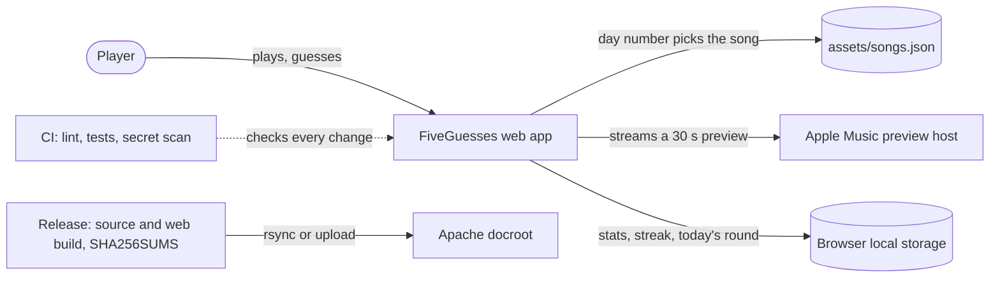

<!-- header:begin: the project page on luminare.tech drops this block, because the page has its own heading -->
<picture>
  <source media="(prefers-color-scheme: dark)" srcset="docs/brand/readme-header-dark.svg">
  <source media="(prefers-color-scheme: light)" srcset="docs/brand/readme-header-light.svg">
  
</picture>

<!-- byline:studio -->
*a [Luminare Development](https://luminare.tech/open-source/fiveguesses/) open-source project*
<!-- /byline:studio -->
<!-- byline:personal
*by ItsPaulAT · [project page](https://luminare.tech/open-source/fiveguesses/)*
/byline:personal -->
<!-- header:end -->

# FiveGuesses

A daily song-guessing game for the browser: five guesses, and every miss doubles the preview you
hear (1, 2, 4, 8 and 16 seconds).

[](https://github.com/luminare-dev/FiveGuesses/actions/workflows/ci.yml)
[](https://github.com/luminare-dev/FiveGuesses/releases)
[](LICENSE)
[](https://scorecard.dev/viewer/?uri=github.com/luminare-dev/FiveGuesses)

## Why

Daily guessing games work because everyone gets the same puzzle and compares results, but most
of them need an account, a backend and a tracker. FiveGuesses keeps everything in the browser: the
daily song comes from a fixed list and the day number, stats and streaks stay in local storage,
and the 30-second previews are streamed from Apple Music and never stored. The repository shows
one Expo (React Native) and TypeScript code base built for the web with react-native-web, playable
by keyboard and screen reader, in a light and a dark theme, with an installable shell that opens
offline, unit and end-to-end tests and pinned CI.

## Quickstart

```bash
git clone https://github.com/luminare-dev/FiveGuesses.git
cd FiveGuesses
npm ci
npm run web
```

The game opens at <http://localhost:8081>. Node.js 22 is required (`.nvmrc`).

## How it works



## Song previews

Previews are 30-second clips streamed from Apple Music through the public iTunes Search API. The
app never downloads or re-hosts them, shows a **Listen on Apple Music** link on every reveal and
the line *Previews courtesy of Apple Music* wherever a preview plays.

*Previews courtesy of Apple Music.*

## Design decisions

The decisions behind this project are recorded as short ADRs in [docs/adr/](docs/adr/):

- [ADR 0001: Record architecture decisions](docs/adr/0001-record-architecture-decisions.md)
- [ADR 0002: Pin every action and downloaded tool](docs/adr/0002-pin-actions-and-downloaded-tools.md)
- [ADR 0003: Secret scanning with the gitleaks binary](docs/adr/0003-secret-scanning-with-the-gitleaks-binary.md)
- [ADR 0004: Draft releases with checksums and provenance](docs/adr/0004-draft-releases-with-checksums-and-provenance.md)
- [ADR 0005: One Expo code base, built for the web first](docs/adr/0005-one-expo-code-base-built-for-the-web.md)
- [ADR 0006: No backend: everything stays in the browser](docs/adr/0006-no-backend-everything-stays-in-the-browser.md)
- [ADR 0007: The daily song comes from the day number](docs/adr/0007-the-daily-song-comes-from-the-day-number.md)
- [ADR 0008: Previews are streamed, never stored](docs/adr/0008-previews-are-streamed-never-stored.md)
- [ADR 0009: The shell works offline, the audio does not](docs/adr/0009-the-shell-works-offline-the-audio-does-not.md)
- [ADR 0010: English strings prepared for translation](docs/adr/0010-english-strings-prepared-for-translation.md)
- [ADR 0011: The web build ships in every release](docs/adr/0011-the-web-build-ships-in-every-release.md)
- [ADR 0012: Logic tests in Jest, UI tests in Playwright](docs/adr/0012-logic-tests-in-jest-ui-tests-in-playwright.md)

## Supported versions

| Component | Tested with | Supported |
|---|---|---|
| Node.js | 22.22.0 | 22.x |
| npm | 10.9.4 | 10.x |
| Expo SDK | 57.0.30 | 57.x |
| React Native / react-native-web | 0.86.3 / 0.21.2 | the versions Expo SDK 57 installs |
| expo-audio | 57.0.5 | the version Expo SDK 57 installs |
| TypeScript | 6.0.3 | 6.x |
| Browsers | Chromium 141 (end-to-end tests); Firefox, Safari and iOS Safari not tested | the two latest major versions of Chrome, Firefox, Safari and iOS Safari |
| Web server for the static build | not tested: `public/.htaccess` is written for Apache 2.4 with `mod_rewrite`, `mod_headers` and `mod_deflate`, and step 6 of [the runbook](docs/runbook.md) checks its headers on the host | Apache 2.4.x; any static host without the `.htaccess` headers |

Fixes go into the latest minor release only. See the
[security policy](https://github.com/luminare-dev/.github/blob/main/SECURITY.md) for reporting.

## Limitations

- Previews need a network connection: the app shell, the song list and your stats work offline,
  the audio does not.
- The song list is a fixed, curated set of 95 tracks in `assets/songs.json`; it is regenerated
  with `node scripts/seed-songs.mjs`, which calls the public iTunes Search API.
- English only. The strings are prepared for translation (`src/i18n/`), but no other language ships.
- Web only. The Expo project can be built for iOS and Android, but only the web build is tested
  and released.
- No accounts and no sync: stats live in the browser's local storage and are gone when it is cleared.
- The daily song changes at your local midnight, so players in different time zones get the new
  song at different moments.
- Mobile browsers require a tap before the first preview plays (autoplay rules); the play button
  is always the first action.

## Results

| What | Value | How it was measured |
|---|---|---|
| Unit tests | 359 tests in 10 files pass | `npm test` (Jest), 2026-10-24 |
| End-to-end tests | 37 scenarios in 12 files pass in Chromium 141 | `npm run e2e` (Playwright in Chromium 141, previews stubbed), 2026-10-24 |
| Web build | 194 kB of JavaScript after gzip (684 kB uncompressed) | `npm run build` prints the bundle size and its gzip size, 2026-10-24 |
| Offline start | the shell, the saved round and the privacy page open with the network switched off | Playwright scenario `e2e/pwa.spec.ts` (`context.setOffline(true)`, then reload), 2026-10-24 |
| Template checks | 0 findings | `python3 scripts/forbidden_words.py`, 2026-10-24 |

## Development

Node.js 22 (`.nvmrc`), npm 10 and Python 3.10 or later. The one command that runs the type check,
the unit tests and the web build, as CI does:

```bash
npm ci && npm run check
```

End-to-end tests run against the built app in Chromium: outside CI, `npm run e2e` uses the binary
at `PW_CHROMIUM_PATH` (default `/opt/pw-browsers/chromium`) when that file exists, otherwise the
Chromium that `npx playwright install chromium` provides, the build that belongs to the
`@playwright/test` version pinned in the lockfile. CI ignores `PW_CHROMIUM_PATH` and runs the same
install command with `--with-deps`. The template checks CI also runs: `python3 -m unittest discover -s tests -v`,
`python3 scripts/forbidden_words.py`, `python3 scripts/set_byline.py verify` and
`python3 scripts/check_workflows.py`; the linters are listed in [docs/install.md](docs/install.md).

Keyboard and screen reader: a whole round can be played without a pointer. Tab moves through
Statistics, About, the play button, the guess box, Skip, Guess and the footer links; Space on the
play button starts the snippet. In the guess box, typing opens the list of matching songs, ArrowDown
and ArrowUp move the highlight, Home and End jump to the first and last entry, Enter guesses the
highlighted song (or an exact match you typed) and Escape closes the list. Every round event is
spoken once through one polite live region, the Statistics and About sheets trap focus and return it
to the button that opened them, and no state is shown by colour alone. The full map is in
[docs/accessibility.md](docs/accessibility.md).

## Documentation and links

- [Installation](docs/install.md) · [Configuration](docs/configuration.md) ·
  [Upgrade](docs/upgrade.md) · [Troubleshooting](docs/troubleshooting.md) ·
  [Runbook](docs/runbook.md) · [Accessibility](docs/accessibility.md) · [ADRs](docs/adr/)
- [Changelog](CHANGELOG.md) and [releases](https://github.com/luminare-dev/FiveGuesses/releases)
  (each release has `SHA256SUMS`; only releases published while the repository is public also carry a
  build provenance attestation)
- [Contributing](https://github.com/luminare-dev/.github/blob/main/CONTRIBUTING.md) ·
  [Code of conduct](https://github.com/luminare-dev/.github/blob/main/CODE_OF_CONDUCT.md) ·
  [Security](https://github.com/luminare-dev/.github/blob/main/SECURITY.md) ·
  [Support](https://github.com/luminare-dev/.github/blob/main/SUPPORT.md)
- Project page: <https://luminare.tech/open-source/fiveguesses/>

## Not affiliated

Not affiliated with or endorsed by Apple. Apple Music and the iTunes Search API are named only to
describe where the song previews come from.

## Licence

[MIT](LICENSE). The licence covers the code only: the project name, logo, header images
and `docs/brand/` are not licensed (see [NOTICE](NOTICE)).

<!-- byline:studio -->
*a [Luminare Development](https://luminare.tech/open-source/fiveguesses/) open-source project*
<!-- /byline:studio -->
<!-- byline:personal
*by ItsPaulAT · [project page](https://luminare.tech/open-source/fiveguesses/)*
/byline:personal -->
